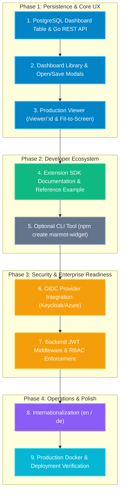

# AGENTS.md — Marmot SCADA / HMI Engineering Guide

> **Target Audience:** Autonomous coding agents, AI pair programmers, and core contributors.  
> **Repository:** `canvas-line-viewer` (Marmot SCADA / HMI)  
> **Status:** Active Development — Advancing from Engineering Prototype to Production v1.0.

---

## 1. Project Mission & High-Level Architecture

Marmot is an industrial SCADA/HMI canvas line viewer and visual designer tailored for discrete manufacturing, assembly lines, and process engineering plants. It bridges shopfloor IoT telemetry (OPC UA, MQTT, PLC registers) with high-performance web visualization and interactive layout authoring.

```
┌────────────────────────────────────────────────────────────────────────────────────────┐
│                                 MARMOT SYSTEM TOPOLOGY                                 │
├────────────────────────────────┬───────────────────────────────────────────────────────┤
│        PLANT FLOOR / EDGE      │                   MARMOT CLOUD                        │
│                                │                                                       │
│  [ PLCs / Machines ]           │   ┌───────────────────────────────────────────────┐   │
│         │ (OPC UA / Modbus)    │   │               PostgreSQL 16                   │   │
│         ▼                      │   │       (TimescaleDB Hypertables)               │   │
│  [ Mosquitto MQTT ]            │   │   - line_telemetry  - machine_layouts         │   │
│         │ (tcp://:1883)        │   │   - edge_datapoints - extensions / dashboards │   │
│         ▼                      │   └──────────────────────┬────────────────────────┘   │
│  [ marmot-edge Gateway ]       │                          │                            │
│    - Go microservice (:3001)   │   ┌──────────────────────┴────────────────────────┐   │
│    - MQTT subscriber           │   │             marmot-cloud REST API             │   │
│    - WS broadcaster (/ws) ─────┼───►   - Go Chi router (:3000)                     │   │
│    - Datapoint catalog sync    │   │   - MinIO Object Storage (SVGs & Bundles)     │   │
│                                │   └──────────────────────┬────────────────────────┘   │
│                                │                          │ (REST / SSE / WS)          │
│                                │                          ▼                            │
│                                │   ┌───────────────────────────────────────────────┐   │
│                                │   │             Frontend SPA (Vue 3)              │   │
│                                │   │   - /designer (Canvas Line Authoring)         │   │
│                                │   │   - /viewer/:id (Kiosk Shopfloor Display)     │   │
│                                │   │   - /admin (Extensions, Sites, Diagnostics)   │   │
│                                │   └───────────────────────────────────────────────┘   │
└────────────────────────────────┴───────────────────────────────────────────────────────┘
```

### Key Architectural Pillars
1. **Designer & Viewer Canvas:** Infinite 2D artboard with pan, zoom, coordinate transformation, component layering (`zIndex`), multi-select, and shape manipulation powered by `vue3-moveable`.
2. **Hybrid Telemetry Engine (Hub & Spoke):**
   - **Real-time Tail:** Edge gateways (`marmot-edge`) ingest plant MQTT messages and broadcast low-latency WebSockets directly to active client browsers.
   - **Historical Analytics:** Central PostgreSQL with TimescaleDB hypertables downsamples metrics using dynamic `time_bucket('auto')` aggregation for instant trend rendering.
   - **Catalog Synchronization:** Edge gateways periodically push known data point definitions to the cloud via `POST /api/edge/datapoints`.
3. **Interactive Industrial SVG Binding:** Engineering CAD and draw.io vector schematics are uploaded to MinIO, sanitized via Go parser, and made interactive on canvas. Users can click any SVG node or compound group to attach dynamic `fill`/`stroke` color rules tied to live PLC telemetry.
4. **Resilient Extension SDK:** Third-party micro-frontend widgets (e.g. specialized tank gauges, custom robotic cell monitors) are uploaded as zip bundles containing ESM JavaScript and `manifest.json`. Bundles execute dynamically via browser ESM `import()` within host error boundaries (`WidgetErrorFallback.vue`).

---

## 2. Technology Stack & Runtime Matrix

| Subsystem | Technology | Version / Tooling | Key Libraries / Notes |
|---|---|---|---|
| **Frontend Framework** | Vue 3 | `^3.5.40` | Composition API (`<script setup lang="ts">`), `sit-onyx` design system (`^1.20.0`), `vue-router` (`^5.2.0`), `vue3-moveable` (`^0.28.0`) |
| **Frontend Tooling** | Vite | `^8.1.5` | `vue-tsc` (`^3.3.7`), `@sit-onyx/icons` (`^1.12.0`), `date-fns` (`^4.4.0`), `chart.js` (`^4.5.1`) |
| **Backend Cloud API** | Go | `1.27` / `1.22+` | `github.com/go-chi/chi/v5`, `github.com/danielgtaylor/huma/v2`, `github.com/jackc/pgx/v5`, `github.com/minio/minio-go/v7` |
| **Edge Gateway** | Go (`marmot-edge`) | `1.27` / `1.22+` | `github.com/eclipse/paho.mqtt.golang`, `github.com/gorilla/websocket` |
| **Time-Series Database** | TimescaleDB | PostgreSQL 16 | Hypertable `line_telemetry`, dynamic downsampling queries |
| **Object Storage** | MinIO / Silo S3 | Latest | Buckets: `dashboards`, `svgs`, `plugins` / `extensions` |
| **Industrial Messaging** | Mosquitto MQTT | Latest | TCP broker `:1883`, WebSocket bridge `:9002` |
| **Package Manager** | PNPM | Latest / Node 22+ | Monorepo / multi-directory workspace (`frontend`, `samples/tank-level`) |

---

## 3. Environment & Build / Test Commands

### 3.1 Infrastructure Setup (Docker Compose)
From the repository root:
```bash
# Start TimescaleDB, MinIO, MinIO Initializer, and Mosquitto MQTT
docker compose up -d

# Verify healthy status
docker compose ps
```
- **PostgreSQL / TimescaleDB:** `localhost:5432` (`postgres:postgres`, DB: `marmot`)
- **MinIO S3 API:** `localhost:9000` (`minioadmin:minioadmin`)
- **MinIO Web Console:** `http://localhost:9001`
- **MQTT Broker:** `localhost:1883` (WS bridge: `localhost:9002`)

### 3.2 Backend Cloud Service (`marmot-cloud`)
Directory: [`backend/`](file:///C:/Users/meich/Desktop/Development/WebDev/canvas-line-viewer/backend)
```bash
cd backend

# Run the cloud backend service (listens on http://127.0.0.1:3000)
go run .
# or run with explicit files:
go run main.go timeseries.go telemetry_history.go svg_handlers.go svg_sanitizer.go extensions.go

# Run Go automated unit and integration tests
go test ./...

# Build standalone production executable
go build -ldflags="-w -s" -o marmot-cloud.exe .
```
API documentation is automatically exposed at `http://127.0.0.1:3000/docs` (via Huma OpenAPI).

### 3.3 Plant Edge Gateway (`marmot-edge`)
Directory: [`backend/cmd/marmot-edge`](file:///C:/Users/meich/Desktop/Development/WebDev/canvas-line-viewer/backend/cmd/marmot-edge)
```bash
cd backend
go run cmd/marmot-edge/main.go
```
- Listens on `http://127.0.0.1:3001`
- Exposes WebSocket telemetry tail at `ws://127.0.0.1:3001/ws`
- Subscribes to MQTT topics (`#` or `line_telemetry/#`) and pushes telemetry messages.

### 3.4 Frontend Application
Directory: [`frontend/`](file:///C:/Users/meich/Desktop/Development/WebDev/canvas-line-viewer/frontend)
```bash
# Install dependencies
pnpm --dir frontend install

# Start Vite development server (http://localhost:5173)
pnpm --dir frontend dev

# Run TypeScript type validation
pnpm --dir frontend type-check

# Build frontend production bundle
pnpm --dir frontend build

# Run linter and formatter
pnpm --dir frontend lint
pnpm --dir frontend format
```

### 3.5 Extension Samples & Widget Scaffolder
Reference widgets live in [`samples/`](file:///C:/Users/meich/Desktop/Development/WebDev/canvas-line-viewer/samples):
- [`samples/tank-level`](file:///C:/Users/meich/Desktop/Development/WebDev/canvas-line-viewer/samples/tank-level) — SVG vessel gauge, `<clipPath>` liquid fill.
- [`samples/trend-counter`](file:///C:/Users/meich/Desktop/Development/WebDev/canvas-line-viewer/samples/trend-counter) — numeric readout with ▲/▼/◆ trend from a sliding window of live samples.

```bash
# Start local widget dev workbench (theme switcher + simulated telemetry)
pnpm --dir samples/tank-level dev

# Type-check and compile ESM bundle (dist/bundle.js)
pnpm --dir samples/tank-level build

# Build and package ready-to-upload zip archive (<id>-<version>.zip)
pnpm --dir samples/tank-level run package
```

Scaffold a new widget project from the extension SDK tooling
([`packages/create-marmot-widget`](file:///C:/Users/meich/Desktop/Development/WebDev/canvas-line-viewer/packages/create-marmot-widget)):
```bash
# Interactive scaffold (templates: minimal | counter | tank)
pnpm create marmot-widget my-widget

# Non-interactive with an explicit template
node packages/create-marmot-widget/index.js my-widget --template counter --category indicator --yes

# Then inside the generated project:
pnpm install && pnpm dev     # develop
pnpm build && pnpm package   # produce my-widget-1.0.0.zip for Admin Panel upload
```
Full developer guide: [`docs/EXTENSION_SDK.md`](file:///C:/Users/meich/Desktop/Development/WebDev/canvas-line-viewer/docs/EXTENSION_SDK.md).

---

## 4. Key Architectural Patterns & Conventions

### 4.1 Global Extension SDK & Dynamic Module Loading
Third-party widgets must not bundle duplicate instances of core frameworks (Vue, Chart.js, Onyx icons) because multiple reactive instances break reactivity and inflate bundle size.

1. **Host SDK Bridge:** [`frontend/src/main.ts`](file:///C:/Users/meich/Desktop/Development/WebDev/canvas-line-viewer/frontend/src/main.ts#L18-L34) exposes:
   ```ts
   window.__MARMOT_SDK__ = {
     vue: Vue,
     icons: OnyxIcons,
     chartjs: ChartJS,
   }
   ```
2. **Import Map:** [`frontend/index.html`](file:///C:/Users/meich/Desktop/Development/WebDev/canvas-line-viewer/frontend/index.html#L15-L21) maps `"vue"` to `/vendor/vue.js`.
3. **Rollup Externals:** Widget bundlers must externalize `vue` and `chart.js` in `vite.config.ts`:
   ```ts
   rollupOptions: {
     external: ['vue'],
     output: {
       globals: {
         vue: 'window.__MARMOT_SDK__.vue',
       },
     },
   }
   ```
4. **CSS Injection Plugin:** External widgets bundle styles directly into `bundle.js` using a custom post-build Rollup hook (`cssInjectedByJsPlugin`) that dynamically appends `<style data-extension="...">` to `document.head`.
5. **Host Error Boundaries:** All dynamic imports run inside [`useExtensionManager.ts`](file:///C:/Users/meich/Desktop/Development/WebDev/canvas-line-viewer/frontend/src/composables/useExtensionManager.ts#L54-L105). If an external widget throws a syntax error, fails module resolution, or panics during rendering, the registry automatically swaps in [`WidgetErrorFallback.vue`](file:///C:/Users/meich/Desktop/Development/WebDev/canvas-line-viewer/frontend/src/components/widgets/WidgetErrorFallback.vue) and [`WidgetErrorConfig.vue`](file:///C:/Users/meich/Desktop/Development/WebDev/canvas-line-viewer/frontend/src/components/widgets/WidgetErrorConfig.vue) without crashing the canvas.

### 4.2 Zero-CSS Policy for Extension Property Inspectors
- **Rule:** External widget config components (`*Config.vue`) must **NOT** package proprietary CSS design systems or styled component libraries.
- **Implementation:** They must utilize host standard CSS classes exposed globally in [`frontend/src/assets/main.css`](file:///C:/Users/meich/Desktop/Development/WebDev/canvas-line-viewer/frontend/src/assets/main.css#L203-L345):
  - Containers: `.marmot-config-stack`, `.section-card`, `.section-title`
  - Form Layout: `.form-row`, `.grid-2x2`, `.field-item`
  - Controls: `.inspector-input`, `.inspector-select`, `.color-row`, `.color-picker`, `.color-presets`, `.color-btn`, `.hex-input`
- For local preview in widget workbenches, include [`marmot-theme.css`](file:///C:/Users/meich/Desktop/Development/WebDev/canvas-line-viewer/samples/tank-level/src/dev/marmot-theme.css) exclusively in dev mode.

### 4.3 Vue Reactivity & Dynamic Component Registration
- **Caution with Dynamic Components:** Storing raw Vue component objects directly inside deeply reactive objects triggers runtime warnings:
  `[Vue warn]: Vue received a Component that was made a reactive object.`
- **Convention:** Always wrap dynamic component definitions in `markRaw()` (e.g., `markRaw(WidgetErrorFallback)`) or use `shallowRef()`.

### 4.4 SVG Coordinate Transformations & Clipping Paths
- **The SVG Defs / Transform Trap:** When applying `<clipPath id="...">` to an SVG element, any `transform` attribute (such as `transform="rotate(90,40,55)"`) on the clipped element causes clip coordinates to evaluate within the element's local transformed coordinate matrix.
- **Convention:** 
  1. Store base SVG paths in absolute, unrotated coordinate space whenever possible.
  2. If clipping dynamic liquid levels, wrap the element in an untransformed `<g :clip-path="`url(#${clipId})`">` to guarantee clean vertical clipping relative to the root artboard.

### 4.5 Telemetry Subscription & Coalescing
- **Real-Time Data Flow:** [`useTelemetry.ts`](file:///C:/Users/meich/Desktop/Development/WebDev/canvas-line-viewer/frontend/src/composables/useTelemetry.ts) maintains a reactive singleton map `telemetryState[dataPointId] = value`. Components read reactive values with zero overhead.
- **Historical Batch Coordinator:** [`useTelemetryCoordinator.ts`](file:///C:/Users/meich/Desktop/Development/WebDev/canvas-line-viewer/frontend/src/composables/useTelemetryCoordinator.ts) debounces mounting widgets (50ms window) and batches multiple `datapointId` subscriptions into a single HTTP request (`GET /api/telemetry/history?datapointId=dp1,dp2&from=1h&bucket=auto`), eliminating N+1 HTTP request spikes on canvas load.

### 4.6 Industrial Theming & Styling Tokens
- Marmot provides two industrial canvas themes:
  - `industrial-dark`: dark slate / zinc backgrounds (`#18181b`), emerald/sky status highlights.
  - `cleanroom-light`: clean light laboratory background (`#f8fafc`).
- Visual component surfaces support:
  - `.widget-glass`: Frosted glassmorphism (`backdrop-filter: blur(12px)`, translucent fill, border line).
  - `.widget-solid`: Opaque industrial surfaces.
  - Custom user overrides via `props.backgroundColor`.

---

## 5. Complete Production Rollout Roadmap (Incorporated from plan.md)

```
┌─────────────────────────────────────────────────────────────────────────────────────────────────┐
│                                   PRODUCTION ROLLOUT MILESTONES                                 │
├────────────────────────────────┬────────────────────────────────┬──────────────────────────────┤
│  PHASE 1: STORAGE & MANAGEMENT │  PHASE 2: PRODUCTION VIEWER    │  PHASE 3: SECURITY & OIDC    │
│  - PostgreSQL Dashboard Table  │  - Responsive Auto-Scaling     │  - OpenID Connect (PKCE)     │
│  - Dashboard CRUD REST API     │  - Kiosk & Fullscreen Modes    │  - RBAC (Admin/Eng/Viewer)   │
│  - Dashboard Library / Modals  │  - Edge WebSocket Binding      │  - Backend JWT Validation    │
│  - Quick-Save & Versioning     │  - TV Wall Multi-Dash Rotation │  - Route Guards & Audit Log  │
├────────────────────────────────┴────────────────────────────────┴──────────────────────────────┤
│  PHASE 4: SDK, EXAMPLES & TOOLING                                PHASE 5: I18N & PRODUCTION OPS│
│  - Full Developer Guide (`docs/EXTENSION_SDK.md`)                - English & German Locales    │
│  - Reference Widget Example (`examples/tank-level-widget`)       - Multi-Stage Docker Build    │
│  - Optional CLI Scaffolder (`npm create marmot-widget`)          - Reverse Proxy & Automated TLS│
└─────────────────────────────────────────────────────────────────────────────────────────────────┘
```

### Phase 1: Dashboard Persistence & Database Storage

#### Target Architecture
Move dashboard configurations from transient `localStorage` into PostgreSQL with MinIO backup, supporting multi-dashboard management, version history, and instantaneous team sharing.

#### 1. Database Schema (`dashboards` table)
```sql
CREATE TABLE IF NOT EXISTS dashboards (
    id            VARCHAR(64) PRIMARY KEY,
    name          VARCHAR(255) NOT NULL,
    description   TEXT,
    site_id       VARCHAR(64) REFERENCES sites(id) ON DELETE SET NULL,
    theme         VARCHAR(64) DEFAULT 'industrial-dark',
    width         INTEGER NOT NULL DEFAULT 1920,
    height        INTEGER NOT NULL DEFAULT 1080,
    background    VARCHAR(64) DEFAULT '#18181b',
    config        JSONB NOT NULL,
    thumbnail_url TEXT,
    version       INTEGER NOT NULL DEFAULT 1,
    created_by    VARCHAR(128) DEFAULT 'system',
    updated_by    VARCHAR(128) DEFAULT 'system',
    created_at    TIMESTAMPTZ DEFAULT NOW(),
    updated_at    TIMESTAMPTZ DEFAULT NOW()
);

CREATE INDEX IF NOT EXISTS idx_dashboards_site_id ON dashboards(site_id);
CREATE INDEX IF NOT EXISTS idx_dashboards_updated_at ON dashboards(updated_at DESC);
```

#### 2. Backend REST Endpoints (Go Chi + PostgreSQL)
| Method | Endpoint | Description |
|---|---|---|
| `GET` | `/api/dashboards` | List dashboards with metadata (ID, name, site, dimensions, updated time, thumbnail) |
| `POST` | `/api/dashboards` | Create a new dashboard record and persist initial JSON config |
| `GET` | `/api/dashboards/{id}` | Retrieve complete dashboard document including all component nodes and bindings |
| `PUT` | `/api/dashboards/{id}` | Update existing dashboard, increment version counter, update timestamp |
| `DELETE` | `/api/dashboards/{id}` | Permanently delete a dashboard |
| `POST` | `/api/dashboards/{id}/duplicate` | Clone dashboard with a new ID (e.g. `Copy of Line 1`) |

#### 3. Frontend Lifecycle Management
- **Dashboard Library Modal (`Ctrl+O`):** Search by title/site, site filter dropdown, card view with actions (Open in Designer, Open in Viewer, Duplicate, Delete).
- **Save As & Metadata Dialog:** Title, site binding, description, and SVG/Canvas thumbnail generation.
- **Dirty State Tracking & Quick-Save (`Ctrl+S`):** Track `isDirty` state comparing current canvas against last loaded state; display orange indicator dot in header; prompt `beforeunload` warning on unsaved edits.
- **Legacy Migration:** Auto-migrate existing `marmot-active-dashboard` in `localStorage` if database is empty.

---

### Phase 2: Production Viewer Experience (`ViewerView.vue`)

#### 1. Real Dynamic Route Resolution
- Pattern: `/viewer/:dashboardId`
- On mount: Fetch dashboard from `/api/dashboards/:dashboardId`, resolve `siteId`, fetch site details (`/api/sites/:siteId`), and auto-connect live WebSocket telemetry to the edge gateway.

#### 2. Responsive Auto-Scaling ("Fit to Screen")
- Compute aspect ratio scaling factor:
  ```ts
  const scale = Math.min(
    viewportWidth / dashboard.width,
    viewportHeight / dashboard.height
  )
  ```
- Center artboard without horizontal/vertical scrollbars.
- Modes: `Fit to Screen` (default), `Original (100%)`, `Fill Screen`.

#### 3. Kiosk Mode & Floating Controls
- Support `?kiosk=true` URL query to strip header, menus, and borders.
- Floating autohide control pill (fades out after 3s idle): fullscreen toggle (`F11`), data refresh, dashboard switcher, live connection health indicator.

#### 4. Multi-Dashboard Carousel Rotation (TV Wall)
- URL format: `/viewer?rotate=dash-1,dash-2,dash-3&interval=30s`
- Cross-fade transition without reloading assets or dropping WebSocket connections.

---

### Phase 3: Authentication & Authorization (OIDC + RBAC)

#### 1. Configuration & Standards
- OpenID Connect (OIDC) / OAuth2 Authorization Code Flow with PKCE.
- Compatible with Keycloak, Authentik, Azure AD / Microsoft Entra ID.

#### 2. Role-Based Access Control (RBAC)
| Permission / Action | Admin | Operator / Engineer | Viewer / Shopfloor |
|---|:---:|:---:|:---:|
| View Dashboards (`/viewer/:id`) | ✅ | ✅ | ✅ |
| Live Telemetry Subscription | ✅ | ✅ | ✅ |
| Design & Modify Dashboards | ✅ | ✅ | ❌ |
| Create / Delete Dashboards | ✅ | ✅ | ❌ |
| Manage Plant Sites & Gateways | ✅ | ❌ | ❌ |
| Upload / Delete Widget Extensions | ✅ | ❌ | ❌ |
| System Diagnostics Access | ✅ | ❌ | ❌ |

#### 3. Backend JWT Middleware (Go Chi)
- Validate `Authorization: Bearer <token>` against OIDC Provider JWKS endpoint (`/.well-known/jwks.json`).
- Verify expiration, audience, issuer; inject user claims (`sub`, `roles`) into context.

---

### Phase 4: Extension SDK Documentation & Tooling — ✅ Delivered

1. ✅ **`docs/EXTENSION_SDK.md`:** Complete third-party developer guide — manifest reference, host prop contracts (`telemetryValues`, `dataPoint`, `backgroundColor`), theme CSS variables (canvas theming is delivered via `data-canvas-theme` CSS variables, not a component prop), the host CSS class library, Vite configuration rationale, packaging/upload workflow, runtime error boundaries, limits, and troubleshooting.
2. ✅ **Second reference widget:** [`samples/trend-counter`](file:///C:/Users/meich/Desktop/Development/WebDev/canvas-line-viewer/samples/trend-counter) — a numeric readout whose trend (▲/▼/◆) is computed from a sliding window of the last N live samples. Complements `samples/tank-level` (SVG `<clipPath>` geometry) by demonstrating internal derived state.
3. ✅ **Scaffolder CLI:** [`packages/create-marmot-widget`](file:///C:/Users/meich/Desktop/Development/WebDev/canvas-line-viewer/packages/create-marmot-widget) — `npm create marmot-widget <name>` with three templates (`minimal`, `counter`, `tank`), pre-configured Vite lib-mode externals, CSS-in-JS injection, manifest generation, dev workbench, and a cross-platform packaging script.
4. ⬜ **Shared Types Package (`@marmot/widget-sdk`):** Optional; a standalone types package publishing the widget/config prop interfaces. Not yet implemented.

---

### Phase 5: Internationalization (i18n) & Production Ops

1. **i18n:** `vue-i18n` with English (`en`) and German (`de`) locales covering designer toolbars, property inspector, admin views, and widgets.
2. **Multi-Stage Dockerfile:** Minimal production runner embedding frontend assets inside Go binary serving container.
3. **Production Docker Compose (`docker-compose.prod.yml`):** Unified orchestration with reverse proxy (Nginx or Caddy) handling automated TLS.

---

## 6. Implementation Sequence & Priority


