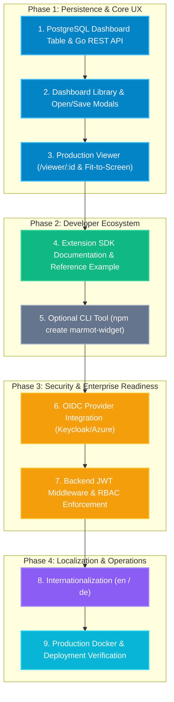

# Marmot SCADA / HMI — Production Rollout Roadmap & Implementation Plan

> **Document Version:** 1.0.0  
> **Target Release:** Marmot Production v1.0  
> **Status:** Planning / Review  

---

## Executive Summary

Marmot is an industrial SCADA/HMI canvas line viewer and designer built for high-throughput discrete manufacturing and process plants. Over the preceding phases, the foundational core was established:
- **Core Designer:** Multi-layer 2D canvas with pan/zoom, coordinate transformation, component layering (z-index), and drag-and-drop manipulation.
- **Telemetry Engine:** TimescaleDB hypertable downsampling with dynamic `time_bucket` aggregation, live MQTT/WebSocket tail synchronization, and debounced request coalescing.
- **Industrial Theming:** CSS token-driven glassmorphism (`.widget-glass`) and solid themes (`.widget-solid`) with unified canvas styling (`industrial-dark`, `cleanroom-light`).
- **Fleet Architecture:** Central Marmot Cloud (PostgreSQL + MinIO + Go REST) paired with plant-level edge gateways (`marmot-edge`).
- **Extension Infrastructure:** MinIO bundle storage, strict `manifest.json` schema validation, 5 MB archive quotas, and host error boundaries protecting runtime stability.

This document outlines the **missing rollout features** required to transition Marmot from a feature-complete engineering prototype to a fully operational, multi-user, enterprise-ready manufacturing platform.

---

```
┌─────────────────────────────────────────────────────────────────────────────────────────────────┐
│                                   PRODUCTION ROLLOUT MILESTONES                                 │
├────────────────────────────────┬────────────────────────────────┬──────────────────────────────┤
│  PHASE 1: STORAGE & MANAGEMENT │  PHASE 2: PRODUCTION VIEWER    │  PHASE 3: SECURITY & OIDC    │
│  - PostgreSQL Dashboard Table  │  - Responsive Auto-Scaling     │  - OpenID Connect (PKCE)     │
│  - Dashboard CRUD REST API     │  - Kiosk & Fullscreen Modes    │  - RBAC (Admin/Eng/Viewer)   │
│  - Dashboard Library / Modals  │  - Edge WebSocket Binding      │  - Backend JWT Validation    │
│  - Quick-Save & Versioning     │  - TV Wall Multi-Dash Rotation │  - Route Guards & Audit Log  │
├────────────────────────────────┴────────────────────────────────┴──────────────────────────────┤
│  PHASE 4: SDK, EXAMPLES & TOOLING                                PHASE 5: I18N & PRODUCTION OPS│
│  - Full Developer Guide (`docs/EXTENSION_SDK.md`)                - English & German Locales    │
│  - Reference Widget Example (`examples/tank-level-widget`)       - Multi-Stage Docker Build    │
│  - Optional CLI Scaffolder (`npm create marmot-widget`)          - Reverse Proxy & Automated TLS│
└─────────────────────────────────────────────────────────────────────────────────────────────────┘
```

---

## 1. Dashboard Persistence & Database Storage

### Current State
Dashboards are currently maintained in reactive memory and serialized into a single `localStorage` key (`marmot-active-dashboard`). There is no multi-dashboard persistence, historical versioning, or central database synchronization.

### Target Architecture
Store dashboard configurations in central PostgreSQL with asset backups in MinIO, allowing multiple dashboards per site, version tracking, and instant multi-client availability.

### Implementation Steps

#### 1.1 Database Schema (`dashboards` table)
```sql
CREATE TABLE IF NOT EXISTS dashboards (
    id            VARCHAR(64) PRIMARY KEY,
    name          VARCHAR(255) NOT NULL,
    description   TEXT,
    site_id       VARCHAR(64) REFERENCES sites(id) ON DELETE SET NULL,
    theme         VARCHAR(64) DEFAULT 'industrial-dark',
    width         INTEGER NOT NULL DEFAULT 1920,
    height        INTEGER NOT NULL DEFAULT 1080,
    background    VARCHAR(64) DEFAULT '#18181b',
    config        JSONB NOT NULL,
    thumbnail_url TEXT,
    version       INTEGER NOT NULL DEFAULT 1,
    created_by    VARCHAR(128) DEFAULT 'system',
    updated_by    VARCHAR(128) DEFAULT 'system',
    created_at    TIMESTAMPTZ DEFAULT NOW(),
    updated_at    TIMESTAMPTZ DEFAULT NOW()
);

CREATE INDEX IF NOT EXISTS idx_dashboards_site_id ON dashboards(site_id);
CREATE INDEX IF NOT EXISTS idx_dashboards_updated_at ON dashboards(updated_at DESC);
```

#### 1.2 Backend REST Endpoints (Go Chi + PostgreSQL)
| Method | Endpoint | Description |
|---|---|---|
| `GET` | `/api/dashboards` | Lists all dashboards with metadata (ID, name, site, dimensions, updated time, thumbnail) |
| `POST` | `/api/dashboards` | Creates a new dashboard record and saves initial JSON config |
| `GET` | `/api/dashboards/{id}` | Retrieves full dashboard document including all component nodes and bindings |
| `PUT` | `/api/dashboards/{id}` | Updates existing dashboard, increments version counter, and updates timestamp |
| `DELETE` | `/api/dashboards/{id}` | Permanently deletes a dashboard |
| `POST` | `/api/dashboards/{id}/duplicate` | Creates an identical clone with a new ID (e.g. `Copy of Line 1`) |

#### 1.3 Automatic Legacy Migration
- When the frontend loads, inspect `localStorage.getItem('marmot-active-dashboard')`.
- If found and the database is empty, prompt the user to migrate it to the database automatically.

---

## 2. Dashboard Lifecycle Management in the Designer

### Current State
The designer header contains an export button and a generic save button. Users cannot browse existing dashboards, switch between dashboards, create new named dashboards, or duplicate existing layouts.

### Implementation Steps

#### 2.1 Dashboard Library Modal ("Open Dashboard")
- Add an "Open Dashboard" button and keyboard shortcut (`Ctrl+O`).
- Modal features:
  - Search bar filtering by title or plant site.
  - Site filter dropdown (e.g. "All Sites", "Hamburg Assembly Hall 3").
  - Card view displaying dashboard name, site badge, dimensions, and last modified date.
  - Direct actions on cards: **Open in Designer**, **Open in Viewer**, **Duplicate**, **Delete**.

#### 2.2 "Save As..." & Dashboard Metadata Dialog
- Allows renaming the dashboard, changing its target plant/site association, and writing an operational description.
- Generates an instant SVG thumbnail snapshot of the current canvas elements to render in the Dashboard Library.

#### 2.3 Dirty State Tracking & Quick-Save (`Ctrl+S`)
- Track a deep-hash / dirty flag (`isDirty = ref(false)`) comparing current canvas state against last loaded state.
- Display an orange "Unsaved Changes" indicator dot next to the dashboard title in the header.
- Add `Ctrl+S` / `Cmd+S` keyboard shortcut for seamless saving without dialog interruption.
- Add browser `beforeunload` warning if unsaved changes exist in memory.

---

## 3. Dedicated Production Viewer Experience (`ViewerView.vue`)

### Current State
`ViewerView.vue` currently hydrates from `localStorage` or falls back to a hardcoded demo. It lacks responsive scaling, kiosk hardening, fullscreen controls, and multi-dashboard rotation for overhead TV monitors.

### Implementation Steps

#### 3.1 Real Dynamic Route Resolution
- URL Pattern: `/viewer/:dashboardId`
- On mount:
  1. Fetch dashboard document via `GET /api/dashboards/:dashboardId`.
  2. Read `siteId` from dashboard metadata.
  3. Fetch site connection details (`GET /api/sites/:siteId`) to retrieve the live edge WebSocket gateway URL (`wsUrl`).
  4. Automatically establish live telemetry connection (`connect(site.wsUrl)`).

#### 3.2 Responsive Auto-Scaling ("Fit to Screen")
Industrial control rooms and shopfloor walls use varying display hardware (1080p TVs, 4K monitors, ultrawide terminals, tablets).
- **Scale-to-Fit Engine:** Calculate aspect-ratio scaling based on dashboard dimensions (`width` x `height`) vs client viewport:
  ```ts
  const scale = Math.min(
    viewportWidth / dashboard.width,
    viewportHeight / dashboard.height
  )
  ```
- **Center Alignment:** Center the canvas artboard precisely with no scrollbars.
- **Scaling Mode Selector:**
  - `Fit to Screen` (default): scales up/down maintaining aspect ratio.
  - `Original (100%)`: 1:1 pixel rendering with panning.
  - `Fill Screen`: stretches to cover display.

#### 3.3 Kiosk & Fullscreen Controls
- Support URL query parameter `?kiosk=true`:
  - Strips top navigation bar, headers, and borders.
  - Maximizes canvas viewport to 100vw × 100vh.
- Floating autohide control pill (fades out after 3 seconds of cursor inactivity):
  - Toggle Fullscreen (`F11`).
  - Refresh Data.
  - Switch Plant / Dashboard.
  - Connection Health Indicator (Live ping / WS status).

#### 3.4 Multi-Dashboard Rotation Mode (TV Wall Carousel)
- Overhead shopfloor monitors frequently need to rotate between multiple views (e.g. *Extruder Line 1* &rarr; *Packaging Line 2* &rarr; *Factory KPI Summary*).
- Support URL format: `/viewer?rotate=dash-1,dash-2,dash-3&interval=30s`.
- Smooth fade transition between dashboards every configured interval without reloading page assets or breaking telemetry sockets.

---

## 4. Full Extension SDK Documentation & Reference Examples

### Current State
Backend upload validation, MinIO storage, and host error boundaries were implemented in Phase 3. However, third-party developers require comprehensive documentation and a working reference template to author their own widgets.

### Implementation Steps

#### 4.1 Developer Documentation (`docs/EXTENSION_SDK.md`)
Create a comprehensive technical guide covering:
1. **Architecture & Global SDK Bridge:**
   - Explanation of `window.__MARMOT_SDK__` (`vue`, `chartjs`, `icons`).
   - Why Vue and Chart.js must be marked `external` in bundler configurations.
2. **`manifest.json` Specification:**
   - Detailed schema documentation for every field (`id`, `name`, `version`, `category`, `defaultSize`, `defaultProps`).
   - Permitted categories (`indicator`, `chart`, `layout`, `annotation`, `custom`).
3. **Widget Props & Runtime Contracts:**
   - Props injected by Marmot:
     - `telemetryValues?: Record<string, unknown>` (live OPC UA / MQTT values keyed by datapoint ID).
     - `dataPoint?: string` (datapoint ID assigned in inspector).
     - `backgroundColor?: string` (`'glass' | 'solid' | 'transparent' | hex`).
     - `unit?: string` (engineering unit).
     - `activeTheme?: string` (`'industrial-dark' | 'cleanroom-light'`).
4. **Theming & Glassmorphism Guidelines:**
   - How to consume `--canvas-theme-*` CSS custom properties.
   - Using `.widget-glass` and `.widget-solid` classes.
5. **Historical Telemetry Access:**
   - How widgets can request downsampled historical aggregates via the telemetry coordinator.
6. **Packaging & Upload Workflow:**
   - Step-by-step instructions: `pnpm build` &rarr; zip bundle &rarr; upload via Admin Panel.

#### 4.2 Production Reference Widget (`examples/tank-level-widget`)
Provide a complete, copy-pasteable reference project:
- **`manifest.json`**: Complete valid manifest for a liquid silo gauge.
- **`TankLevelWidget.vue`**:
  - Animated SVG liquid wave shader.
  - Percentage and absolute volume readouts.
  - High-alarm and low-alarm visual indicators.
  - Inherits canvas frosted glass themes seamlessly.
- **`TankLevelConfig.vue`**:
  - Properties panel component for setting tank capacity, alarms, liquid color, and binding telemetry.
- **`vite.config.ts`**: Pre-configured Rollup externals and library output mode.
- **`package.json`**: Build script outputting ready-to-upload `tank-level-1.0.0.zip`.

---

## 5. Authentication & Authorization (OIDC + RBAC)

### Current State
Simulated roles (`admin`, `operator`, `viewer`) and permission predicates exist in `useAuth.ts`, with security checks currently bypassed for testing (`authEnforced = false`).

### Target Architecture
Integrate standard OpenID Connect (OIDC) / OAuth2 with Authorization Code Flow + PKCE, compatible with enterprise identity providers (Keycloak, Authentik, Azure AD / Entra ID, Okta).

### Implementation Steps

#### 5.1 Configuration & Flags
Environment-driven toggle in `.env`:
```env
AUTH_ENABLED=false          # Set true to enforce real OIDC login
OIDC_ISSUER=https://auth.corp.lan/realms/marmot
OIDC_CLIENT_ID=marmot-web
OIDC_REDIRECT_URI=http://localhost:5173/auth/callback
```

#### 5.2 Role-Based Access Control (RBAC) Matrix
| Permission / Action | Admin | Operator / Engineer | Viewer / Shopfloor |
|---|:---:|:---:|:---:|
| View Dashboards (`/viewer/:id`) | ✅ | ✅ | ✅ |
| Live Telemetry Subscription | ✅ | ✅ | ✅ |
| Design & Modify Dashboards | ✅ | ✅ | ❌ |
| Create / Delete Dashboards | ✅ | ✅ | ❌ |
| Manage Plant Sites & Gateways | ✅ | ❌ | ❌ |
| Upload / Delete Widget Extensions | ✅ | ❌ | ❌ |
| System Diagnostics Access | ✅ | ❌ | ❌ |

#### 5.3 Backend JWT Verification Middleware (Go Chi)
- Intercept incoming requests to `/api/dashboards`, `/api/sites`, `/api/extensions`.
- When `AUTH_ENABLED=true`:
  1. Extract `Authorization: Bearer <token>`.
  2. Validate token against OIDC Provider JWKS endpoint (`/.well-known/jwks.json`).
  3. Verify token expiration, audience, and issuer.
  4. Inject user claims (`sub`, `roles`) into request context.
  5. Reject unauthorized actions with HTTP 401 / 403.

#### 5.4 Frontend Navigation Guards (`router.beforeEach`)
- Guard `/designer` and `/admin` routes.
- Redirect unauthenticated users to the identity provider.
- Conditionally render admin tabs and designer controls based on user role.

---

## 6. Optional: NPM Package & CLI Starter (`npm create marmot-widget`)

### Current State
Widget authors must manually configure `vite.config.ts` and `manifest.json`.

### Target Architecture
A zero-config CLI scaffolding tool to bootstrap new widgets in seconds.

### Implementation Steps

#### 6.1 Interactive Scaffolder CLI
Command:
```bash
npm create marmot-widget@latest
# or: pnpm create marmot-widget
```
Interactive prompts:
1. Widget Name (e.g. *Vibration Spectrum Analyzer*)
2. Widget ID (auto-suggested slug: `vibration-spectrum`)
3. Widget Category (`indicator`, `chart`, `layout`, `annotation`, `custom`)
4. Author / Organization Name
5. Include Inspector Config Component? (`Yes` / `No`)

#### 6.2 Output Structure
Generates a ready-to-run template:
- TypeScript + Vue 3 Single-File Components.
- Bundler pre-configured with correct `external` settings for `vue` and `chart.js`.
- Automated packaging script (`pnpm run package`) that builds and zips the bundle automatically into `dist/<widget-id>-<version>.zip`.

#### 6.3 Shared Types Package (`@marmot/widget-sdk`)
Publish TypeScript definitions to npm or as a workspace package:
- `WidgetManifest`
- `WidgetProps<T>`
- `WidgetConfigProps<T>`
- `TelemetryPoint`

---

## 7. Internationalization (i18n)

### Current State
Hardcoded English strings across the interface.

### Target Architecture
Multi-lingual interface supporting **English (`en`)** and **German (`de`)** (the standard industrial languages in European automation and manufacturing), integrated with `@sit-onyx` design system translations.

### Implementation Steps
1. Install `vue-i18n` (v9/v10).
2. Create locale message dictionaries:
   - `frontend/src/locales/en.json`
   - `frontend/src/locales/de.json`
3. Localize:
   - Designer toolbars, menus, and component palette.
   - Property Inspector labels, alignment tools, and z-index controls.
   - Admin Panel tabs, forms, and diagnostic alerts.
   - Standard widget titles and tooltips.
4. Add Language switcher in Header settings menu with persistent preference in `localStorage`.

---

## 8. Production Deployment, Hardening & DevOps Rollout

### Implementation Steps

#### 8.1 Multi-Stage Production Dockerfile (`Dockerfile`)
```dockerfile
# Stage 1: Build Frontend Assets
FROM node:20-alpine AS frontend-builder
WORKDIR /app/frontend
COPY frontend/package.json frontend/pnpm-lock.yaml ./
RUN corepack enable && pnpm install --frozen-lockfile
COPY frontend/ ./
RUN pnpm run build

# Stage 2: Build Backend Binary
FROM golang:1.22-alpine AS backend-builder
WORKDIR /app/backend
COPY backend/go.mod backend/go.sum ./
RUN go mod download
COPY backend/ ./
RUN CGO_ENABLED=0 GOOS=linux go build -ldflags="-w -s" -o marmot-cloud .

# Stage 3: Minimal Production Runner
FROM alpine:3.19
WORKDIR /app
COPY --from=backend-builder /app/backend/marmot-cloud /app/marmot-cloud
COPY --from=frontend-builder /app/frontend/dist /app/public
EXPOSE 3000
CMD ["/app/marmot-cloud"]
```

#### 8.2 Production Compose (`docker-compose.prod.yml`)
- Single unified compose file orchestrating:
  - `marmot-cloud` (Go REST engine + embedded frontend SPA serving).
  - `timescaledb` (PostgreSQL 16 TimescaleDB with hypertable retention policies).
  - `minio` (S3 object storage for extensions and layouts).
  - `mosquitto` (Industrial edge MQTT broker).
  - `reverse-proxy` (Nginx or Caddy with automated HTTPS/TLS certificate termination).

---

## Rollout Sequence & Recommended Prioritization



### Immediate Next Step
Begin **Phase 1 (Dashboard Persistence & Database Storage)**:
1. Define the PostgreSQL `dashboards` table in `backend/` and `docker/timescale/init.sql`.
2. Implement backend CRUD endpoints (`GET /api/dashboards`, `POST /api/dashboards`, `PUT /api/dashboards/{id}`, `DELETE /api/dashboards/{id}`) in `backend/dashboards.go`.
3. Create `frontend/src/composables/useDashboards.ts` and integrate the "Save Dashboard", "Save As...", and "Open Dashboard" dialogs into the Designer header.
